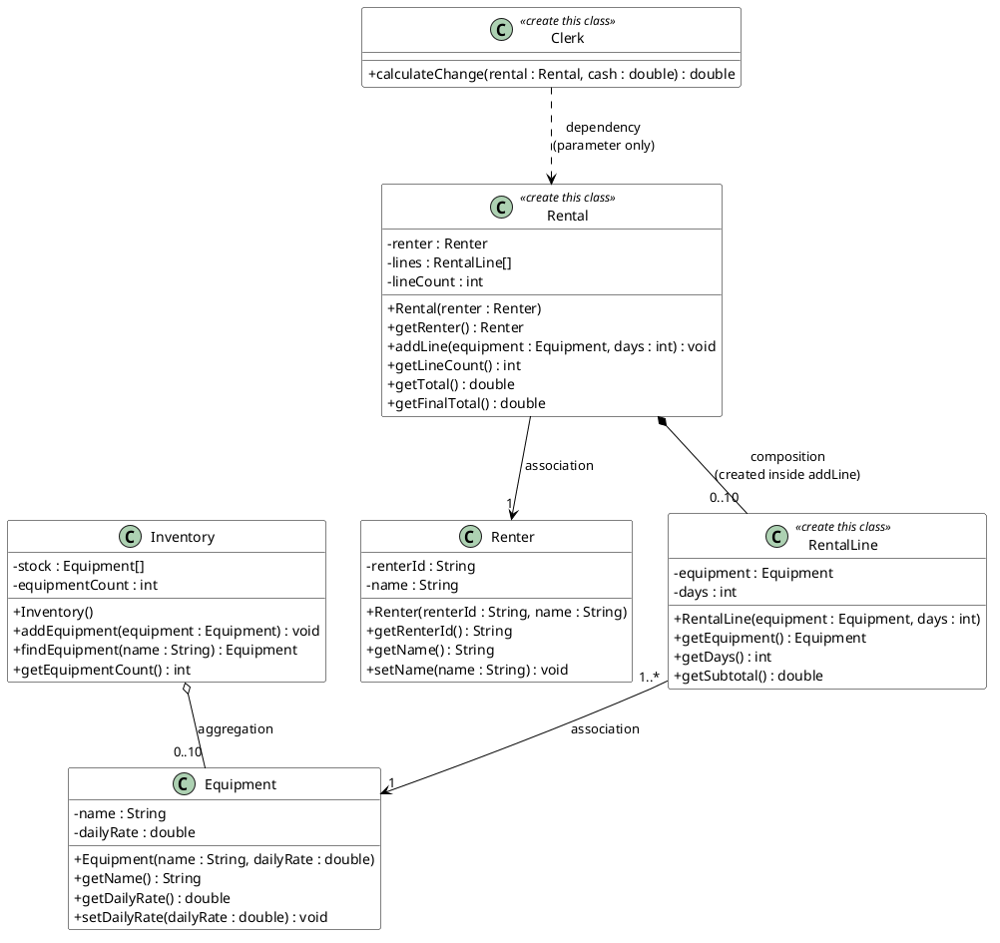

# OOP Practice Quiz (Make-up) — Lab Equipment Rental

🇮🇩 Versi Bahasa Indonesia: [README.id.md](README.id.md)

> **Make-up quiz.** This quiz is for students who missed the main quiz (`oop-quiz`, Cafe Cashier). The concepts, structure, difficulty, number of tests, and grading weights are identical. Only the case study is different.

## Case Study

You are building the core of a simple **lab equipment rental application**:

- The lab has an **inventory** of equipment that can be rented (tripods, studio lights, cameras, ...). Each piece of equipment has a **daily rate**.
- A **renter** makes a **rental** containing one or more pieces of equipment, each for a number of **days**.
- Rentals of **Rp 100,000 or more** get a **10% discount**.
- The **clerk** receives cash and calculates the change.

This quiz covers four OOP concepts: **class**, **object**, **encapsulation**, and **class relations** (association, aggregation, composition, dependency).

## Class Diagram

The class diagram is your **primary specification**: every class, field, constructor, and method signature you need is defined there. Read it carefully.



Classes marked **«create this class»** do not exist yet — you must create them yourself.

### The 4 Class Relations in This Project

| Relation | Where | Meaning here |
|---|---|---|
| **Association** | `RentalLine → Equipment`, `Rental → Renter` | The object holds a reference to another object that lives on its own. |
| **Aggregation** | `Inventory ◇→ Equipment` | `Inventory` collects `Equipment` objects that are **created outside** and passed in; they can exist without the inventory. |
| **Composition** | `Rental ◆→ RentalLine` | `Rental` **creates its own** `RentalLine` objects inside `addLine(...)`; they cannot exist without the rental. |
| **Dependency** | `Clerk ⇢ Rental` | `Clerk` only **uses** a `Rental` as a method parameter; it never stores it in a field. |

## Getting Started

This repository is a **template**:

1. Click the green **Use this template** button (top right) → **Create a new repository**, set the visibility to **Private**, and name it e.g. `oop-quiz-susulan-<your-name>`.
2. Clone **your** new repository:
   ```bash
   git clone git@github.com:<your-username>/oop-quiz-susulan-<your-name>.git
   ```
3. Open the project in your editor (see below), implement the classes, then commit and push.
4. Every push runs the autograder. Open the **Actions** tab in your repository to see your score. If GitHub asks you to enable workflows the first time, click **I understand my workflows, enable them**.

## Opening the Project

This is a standard Maven project — no extra configuration needed.

**NetBeans**
1. **File → Open Project…**
2. Select the cloned `oop-quiz-susulan-...` folder (NetBeans recognizes it as a Maven project automatically) → **Open Project**.
3. Right-click the project → **Test** to run all tests, or run a single test file from the `Test Packages` node.

**Visual Studio Code**
1. Install the **Extension Pack for Java** (Microsoft) from the Extensions view.
2. **File → Open Folder…** and select the cloned folder.
3. Run tests from the **Testing** (flask icon) side bar, or via the terminal:
   ```bash
   mvn test
   ```

## Part 1 — Complete the Skeleton Classes

`Equipment`, `Renter`, and `Inventory` already exist in `src/main/java/id/ac/polinema/oop/`. Replace every `throw new UnsupportedOperationException(...)` with a working implementation. The structure (fields, constructors, signatures) comes from the class diagram; the behavior rules are:

- **`Equipment`** — `setDailyRate` **ignores** a **negative** rate and keeps the old rate.
- **`Renter`** — `setName` **ignores** a **null or blank** name and keeps the old name.
- **`Inventory`** *(aggregation)* — the array has capacity **10**. `addEquipment` stores the equipment at index `equipmentCount` and increments the counter; when the inventory is full it does nothing. `findEquipment` matches the exact name and returns `null` when not found.

**Use plain arrays — do NOT use `List`/`ArrayList`** (Collections are next meeting's topic).

## Part 2 — Create the New Classes

`RentalLine`, `Rental`, and `Clerk` do **not** exist. Create them in `src/main/java/id/ac/polinema/oop/` exactly as drawn in the class diagram. Behavior rules:

- **`RentalLine`** *(association)* — `getSubtotal()` returns the equipment's daily rate × days.
- **`Rental`** *(composition, association)* — the array has capacity **10**, like `Inventory`. `addLine(Equipment, int)` **creates the `RentalLine` inside the method** (this is the composition!); when the rental is full it does nothing. `getTotal()` sums every line's subtotal. `getFinalTotal()` applies a **10% discount** when the total is **≥ 100000**, otherwise returns the total unchanged.
- **`Clerk`** *(dependency)* — no fields; `Rental` is only a parameter. `calculateChange(Rental, double)` returns the cash minus the final total.

Tip: work in the grading-table order below — the points are small and incremental, so every step you finish is immediately reflected in your score.

## Try the App Manually

`Main.java` is a free playground (not graded). After finishing all classes, write your demo there, for example:

```java
public static void main(String[] args) {
    Inventory inventory = new Inventory();
    inventory.addEquipment(new Equipment("Tripod", 18000));
    inventory.addEquipment(new Equipment("Lampu Studio", 12000));

    Renter sari = new Renter("R001", "Sari Wulandari");
    Rental rental = new Rental(sari);
    rental.addLine(inventory.findEquipment("Tripod"), 2);
    rental.addLine(inventory.findEquipment("Lampu Studio"), 1);

    Clerk clerk = new Clerk();
    double cash = 50000;

    System.out.println("Renter  : " + rental.getRenter().getName());
    System.out.println("Total   : " + rental.getTotal());
    System.out.println("Payable : " + rental.getFinalTotal());
    System.out.println("Cash    : " + cash);
    System.out.println("Change  : " + clerk.calculateChange(rental, cash));
}
```

Run it from NetBeans (**Run Project**), VS Code (**Run** above `main`), or the terminal:

```bash
mvn -q compile exec:java
```

Expected output:

```
Renter  : Sari Wulandari
Total   : 48000.0
Payable : 48000.0
Cash    : 50000.0
Change  : 2000.0
```

## Grading

Total **100 points**, split across 12 small test groups (run via GitHub Actions on every push). Run them locally first:

```bash
mvn test                                  # everything
mvn test -Dtest=EquipmentConstructorTest  # a single group
```

| # | Test Group | Concept | Points |
|---|---|---|---|
| 1 | Equipment Constructor Test | class & object | 5 |
| 2 | Equipment Getter Test | class & object | 5 |
| 3 | Equipment Encapsulation Test | encapsulation | 10 |
| 4 | Renter Test | encapsulation | 10 |
| 5 | Inventory Aggregation Test | aggregation | 10 |
| 6 | RentalLine Class Structure Test | new class, association | 10 |
| 7 | RentalLine Subtotal Test | object behavior | 5 |
| 8 | Rental Class Structure Test | new class, association | 10 |
| 9 | Rental Add Line Test | composition | 10 |
| 10 | Rental Total Test | relation traversal | 10 |
| 11 | Rental Discount Test | business logic | 5 |
| 12 | Clerk Test | dependency | 10 |
| | **Total** | | **100** |

## Rules

- **Do not modify** any files under `src/test/**` or `.github/**`.
- Follow the class diagram exactly — class names, field names, method names, and signatures are used by the autograder as drawn.
- All fields must be `private` (this is checked by the tests).
- Use plain arrays only — no `List`, `ArrayList`, or any other Collection.
